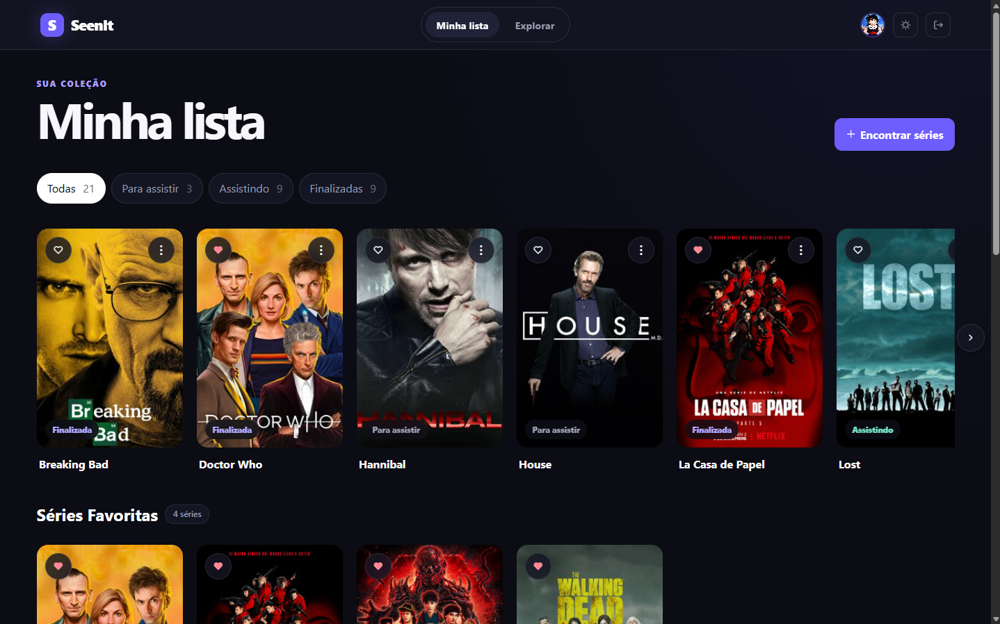

# 🎬 SeenIt

O **SeenIt** é uma aplicação web para acompanhar séries e animes de forma simples e personalizada.

Com ele, é possível pesquisar títulos, organizar o que você pretende assistir, acompanhar o que está assistindo, marcar séries como finalizadas, salvar favoritos e consultar temporadas e episódios em um único lugar.

O projeto nasceu como uma aplicação pessoal e vem evoluindo continuamente, tanto em funcionalidades quanto em arquitetura, segurança e experiência do usuário.

---

## 📸 Preview



> Tela **Minha Lista**, onde o usuário pode acompanhar séries e animes, alterar status, gerenciar favoritos e acessar os detalhes de cada título.

---

## ✨ Funcionalidades

### 🔐 Conta e autenticação

- Criar uma conta.
- Fazer login na aplicação.
- Autenticação utilizando JWT.
- Rotas protegidas para funcionalidades que dependem do usuário autenticado.
- Lista pessoal isolada por usuário.

### 🔎 Explorar

- Pesquisar séries e animes utilizando o catálogo da [TVmaze](https://www.tvmaze.com/).
- Visualizar informações detalhadas sobre cada título.
- Consultar temporadas e episódios.
- Adicionar títulos diretamente à lista pessoal.

### 📺 Minha Lista

Cada usuário possui sua própria coleção de títulos.

É possível classificar uma série como:

- **Para assistir**
- **Assistindo**
- **Finalizada**

Também é possível:

- Alterar o status de uma série.
- Remover títulos da coleção.
- Adicionar ou remover títulos dos favoritos.
- Acessar os detalhes diretamente pela lista.

### ❤️ Favoritos

Os favoritos são independentes do status da série.

A tela **Minha Lista** possui uma seção exclusiva de **Séries Favoritas**, permitindo visualizar rapidamente os títulos marcados pelo usuário.

O favorito também pode ser removido diretamente pelo coração exibido no card.

### 🍥 Animes

O SeenIt identifica automaticamente títulos classificados com o gênero `Anime` pela TVmaze.

Eles são organizados separadamente em:

- **Animes**
- **Animes Favoritos**

Os filtros de status continuam considerando toda a coleção, incluindo séries e animes, sem duplicar títulos entre as seções.

A classificação é armazenada na lista do usuário. Títulos adicionados anteriormente também podem ser classificados automaticamente ao carregar a coleção.

Caso a TVmaze esteja temporariamente indisponível, a lista continua acessível e a classificação pendente pode ser realizada posteriormente.

### 🎞️ Episódios

Dentro dos detalhes de uma série, o usuário pode:

- Visualizar episódios separados por temporada.
- Acompanhar os episódios disponíveis para cada título.
- Registrar episódios assistidos.
- Informar sentimentos relacionados ao episódio.
- Selecionar um personagem favorito do episódio.

O status da série também pode evoluir automaticamente conforme o acompanhamento dos episódios.

---

## 🛠️ Tecnologias

### Frontend

- **Angular 21**
- **TypeScript**
- **Standalone Components**
- **Angular Signals**
- **PrimeNG**

### Backend

- **C#**
- **.NET 10**
- **ASP.NET Core Web API**
- **Entity Framework Core**
- **PostgreSQL**
- **JWT Authentication**

### Integrações

- **TVmaze API**

---

## 🏗️ Arquitetura

O projeto é dividido entre frontend e backend:

```text
seenit/
├── frontend/                 # Aplicação Angular
├── backend/
│   └── SeenIt.Api/           # API ASP.NET Core
└── docs/
    └── images/               # Imagens utilizadas na documentação
```

O frontend não acessa diretamente a TVmaze.

As consultas são realizadas pelo backend do SeenIt, que atua como intermediário entre a aplicação e a API externa.

```text
┌──────────────┐
│   Angular    │
│   Frontend   │
└──────┬───────┘
       │
       │ HTTP / JWT
       ▼
┌──────────────┐
│   SeenIt     │
│  .NET API    │
└──────┬───────┘
       │
       ├──────────────► PostgreSQL
       │
       └──────────────► TVmaze API
```

Essa abordagem mantém o frontend desacoplado da estrutura da API externa e permite que o backend adapte os dados antes de enviá-los para a interface.

---

## 🔒 Segurança

O SeenIt utiliza autenticação baseada em **JWT** para proteger os recursos relacionados à conta do usuário.

Informações sensíveis e configurações específicas de produção não devem ser armazenadas diretamente no código-fonte.

Em ambientes publicados, configurações como:

- chave de assinatura JWT;
- connection string do banco de dados;
- configurações específicas de ambiente;

devem ser fornecidas através de **variáveis de ambiente** ou mecanismos apropriados de gerenciamento de segredos.

---

## 🚀 Executando localmente

### Pré-requisitos

Antes de iniciar, instale:

- [.NET SDK 10](https://dotnet.microsoft.com/)
- [Node.js](https://nodejs.org/)
- PostgreSQL
- Angular CLI compatível com o projeto

---

### Backend

Acesse o diretório da API:

```bash
cd backend/SeenIt.Api
```

Restaure as dependências:

```bash
dotnet restore
```

Aplique as migrations:

```bash
dotnet ef database update
```

Execute a API:

```bash
dotnet run --urls "https://localhost:7042;http://localhost:5042"
```

---

### Frontend

Em outro terminal:

```bash
cd frontend
```

Instale as dependências:

```bash
npm install
```

Inicie a aplicação:

```bash
npm start
```

Acesse:

```text
http://localhost:4200
```

Depois, crie uma conta, faça login e comece a montar sua lista.

---

## 🌐 Principais endpoints

### Autenticação

| Método | Endpoint | Autenticação | Descrição |
|---|---|---:|---|
| `POST` | `/api/auth/register` | Não | Cria uma nova conta |
| `POST` | `/api/auth/login` | Não | Realiza o login |

### Séries

| Método | Endpoint | Autenticação | Descrição |
|---|---|---:|---|
| `GET` | `/api/series/search?q=` | Não | Pesquisa títulos |
| `GET` | `/api/series/{id}` | Não | Retorna os detalhes de uma série |
| `GET` | `/api/series/{id}/episodes` | Não | Retorna os episódios |

### Minha Lista

| Método | Endpoint | Autenticação | Descrição |
|---|---|---:|---|
| `GET` | `/api/my-series` | Sim | Retorna a coleção do usuário |
| `POST` | `/api/my-series` | Sim | Adiciona ou atualiza um título |
| `PUT` | `/api/my-series/{id}/status` | Sim | Altera o status |
| `PUT` | `/api/my-series/{id}/favorite` | Sim | Adiciona ou remove dos favoritos |
| `DELETE` | `/api/my-series/{id}` | Sim | Remove um título da coleção |

> A lista acima apresenta os principais endpoints da aplicação e pode evoluir conforme novas funcionalidades forem adicionadas.

---

## 🗺️ Evolução do projeto

O SeenIt continua em desenvolvimento.

Entre os objetivos do projeto estão:

- aprimorar a experiência de acompanhamento de episódios;
- expandir informações disponíveis nos detalhes das séries;
- melhorar a experiência visual da aplicação;
- evoluir segurança e observabilidade;
- continuar aprimorando a arquitetura para ambiente de produção.

---

## 📚 Fonte dos dados

As informações sobre séries, temporadas, episódios, elenco e demais dados relacionados aos títulos são obtidas através da **TVmaze API**.

[TVmaze](https://www.tvmaze.com/) é um serviço externo e independente do SeenIt.

---

## 👩‍💻 Projeto pessoal

O SeenIt é um projeto pessoal desenvolvido com o objetivo de aplicar e aprofundar conhecimentos em desenvolvimento full stack utilizando **Angular**, **.NET**, **PostgreSQL**, integração com APIs externas, autenticação e publicação de aplicações web.
